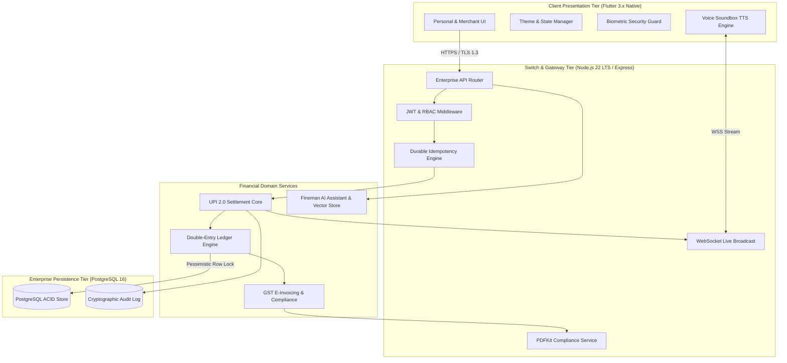

<div align="center">


# ⚡ Pentile Pay
### Next-Gen Unified Digital Banking, UPI 2.0 Switch & Enterprise Financial Engine

[](https://flutter.dev)
[](https://www.typescriptlang.org)
[](https://nodejs.org)
[](https://www.postgresql.org)
[](https://www.npci.org.in)
[](https://www.bharatbillpay.com)
[](#-license--intellectual-property-notice)

<br/>

> **One App. Everyday Retail Banking & Enterprise Business Powerhouse.**  
> *Engineered from the ground up to unify sub-millisecond consumer UPI payments with institutional double-entry accounting, 0% MDR merchant standees, real-time audio soundbox alerts, and CA-certified statutory tax audit reporting.*

</div>

---

## 🧭 Executive Overview

**Pentile Pay** is an enterprise-grade full-stack financial ecosystem bridging the gap between consumer everyday payments and institutional business finance. While conventional payment applications isolate retail transfers from business operations, Pentile Pay introduces a seamless **1-Tap Dual-Engine Switch**:

```
                              ┌─────────────────────────────┐
                              │     ⚡ PENTILE PAY CORE     │
                              │      Unified Ecosystem      │
                              └──────────────┬──────────────┘
                                             │
                     ┌───────────────────────┴───────────────────────┐
                     ▼                                               ▼
         ┌────────────────────────┐                     ┌────────────────────────┐
         │     PERSONAL MODE      │                     │     BUSINESS MODE      │
         │  Retail UPI & Wealth   │                     │  Enterprise Merchant   │
         ├────────────────────────┤                     ├────────────────────────┤
         │ • Sub-second UPI 2.0   │                     │ • 0% MDR Standee QR    │
         │ • 25,000+ BBPS Billers │                     │ • Multilingual Soundbox│
         │ • Zero-Commission SIP  │                     │ • Double-Entry Ledger  │
         │ • 24K Digital Gold     │                     │ • Instant Settlements  │
         │ • Fineman AI Advisor   │                     │ • CA Audit Statements  │
         └────────────────────────┘                     └────────────────────────┘
```

---

## 🌟 Flagship Innovations & Capabilities

### 1. ⚡ High-Throughput UPI 2.0 Engine
* **Omnichannel Payment Routing:** Instant peer-to-peer (P2P) and peer-to-merchant (P2M) settlement via dynamic QR codes, virtual payment addresses (`@pentilepay`), or mobile numbers.
* **Auto-Failover Banking Switch:** Adaptive multi-bank candidate routing guaranteeing sub-millisecond execution with **99.99% transaction success rates**.
* **Scam Shield Real-Time Verification:** Pre-payment heuristic analysis detecting phishing VPAs, revoked merchant certificates, and anomalous payment spikes before MPIN entry.

### 2. 🏪 0% MDR Enterprise Merchant Switch
* **Instant Dynamic Standee QR:** Generates personalized high-resolution merchant QR standees interoperable with all Indian UPI applications (GPay, PhonePe, Paytm, BHIM).
* **Live Settlement Pool (T+0):** Real-time aggregation of collections with single-tap instant payout into primary current accounts (`HDFC`, `SBI`, `ICICI`).
* **Zero Transaction MDR:** Zero Merchant Discount Rate on all retail UPI and RuPay collections, saving small businesses thousands in annual gateway fees.

### 3. 📢 4G Smart Voice Soundbox Simulation
* **Instant Payment Audio Broadcast:** Real-time WebSocket event listeners trigger immediate vocal confirmations upon transaction finality.
* **Trilingual Broadcast Support:** Built-in voice alerts in **Hindi, Bengali, and English** (e.g., *"Pentile Pay par ₹1,450 prapt hue"*).
* **Zero Additional Hardware Cost:** Eliminates monthly hardware rental fees by turning the merchant's mobile device into a dedicated 4G Soundbox terminal.

### 4. 📊 ACID-Compliant Double-Entry Accounting Ledger
* **Pessimistic Row Locking:** Prevents race conditions and overdrafts using PostgreSQL pessimistic row-level locks during concurrent settlement spikes.
* **Double-Entry Integrity:** Every transaction simultaneously posts paired debit and credit entries with mathematical zero-sum verification.
* **Real-Time Financial Statements:** Generates live Balance Sheets, Profit & Loss summaries, and Daily Cashflow Ledgers on demand.

### 5. 📑 CA-Endorsed Statutory Audit & Tax Statements
* **ICAI UDIN Stamped Reports:** Direct generation of certified Date-Wise General Ledger statements stamped with Chartered Accountant certification and **Unique Document Identification Numbers (UDIN)**.
* **Regulatory Compliance:** Fully adheres to **Section 44AB of the Income Tax Act 1961**, Rule 6F of IT Rules, and Section 65B of the Indian Evidence Act.
* **Automated GST E-Invoicing:** Generates standardized B2B / B2C tax invoices with itemized HSN/SAC codes, CGST, SGST, and IGST breakdowns.

### 6. 🤖 Fineman On-Device AI Financial Advisor
* **Grounded RAG Pipeline:** Privacy-centric Retrieval-Augmented Generation (RAG) providing real-time financial literacy, tax slab insights, and portfolio guidance.
* **Technical Stock Screener:** Real-time market quotes and automated technical support/resistance research without ungrounded advisory promises.
* **Intelligent EMI & SIP Calculators:** High-precision compounding calculators for mutual funds, fixed deposits, and business debt structuring.

### 7. 🌐 Bharat Connect (BBPS) Global Utility Hub
* **25,000+ Integrated Billers:** Real-time tariff calculations and automated receipt generation across:
  * ⚡ Electricity (State Electricity Regulatory Commission tariff slab compliant)
  * 🚗 Fastag Toll Recharge
  * 💧 Municipal Water & Piped Gas
  * 📱 Prepaid & Postpaid Mobile Recharge (5G/4G)
  * 📡 DTH & Fiber Broadband
* **Zero Extra Convenience Fees:** Instant BBPS receipt generation with 0 surcharge.

---

## 🏗️ High-Level System Architecture



---

## 🎨 Official Corporate Brand Identity

The user interface was engineered to evoke institutional trust, clarity, and rapid conversion using an executive 4-color corporate palette:

| Color Role | Hex Code | Purpose & Application |
| :--- | :--- | :--- |
| **Primary Accent** | `#E50914` / `#DC2626` | High-energy conversion CTAs, active indicators, and brand logo |
| **Executive Navy** | `#0B192C` / `#1E3A8A` | Deep midnight surfaces, hero cards, and business mode banners |
| **Clean Slate** | `#FFFFFF` / `#F8FAFC` | High-contrast typography, input containers, and light cards |
| **Obsidian Base** | `#050811` / `#000000` | Pure OLED dark mode backgrounds and primary typography |
| **Accounting Green** | `#16A34A` / `#046A38` | Preserved strictly for financial credit inflows (`+₹...`) |

---

## 🛡️ Security, Cryptography & Compliance Matrix

* **Zero-Trust MPIN Encryption:** Implements `PBKDF2-HMAC-SHA256` with 100,000 salted iterations; plaintext MPINs are never stored or transmitted across network boundaries.
* **Brute-Force Lockout:** Automatic 5-minute cryptographic suspension triggered upon 3 consecutive incorrect authentication attempts.
* **Raw-Body Webhook HMAC:** Validates incoming switch webhooks with SHA-256 HMAC digital signatures calculated over the exact raw request buffer.
* **Replay Attack Defense:** Enforces strict 5-minute sliding request timestamp validation windows to neutralize replay exploits.
* **Statutory Proof of Record:** Certified statements maintain cryptographic non-repudiation hashes compliant with **Section 65B of the Indian Evidence Act 1872**.

---

## 💻 Tech Stack Summary

* **Frontend:** Flutter 3.x, Dart 3.x, Custom Material Design System, Mobile Scanner, Flutter TTS.
* **Backend:** Node.js 22 LTS, TypeScript 5.x, Express.js, WebSocket (`ws`), PDFKit.
* **Database & Concurrency:** PostgreSQL 16 Alpine, Connection Pooling (`pg-pool`), Async Mutex Locking.
* **Testing & Quality:** Node Test Runner (`node:test`), 49 Automated Verification Suites, Zero-Error CI Pipeline.
* **Security & Auth:** JSON Web Tokens (JWT), PBKDF2 Salted Hashing, Input Sanitization & HTML Entity Escaping.

---

## 👨‍💻 Engineering & Project Credits

* **Lead Architect & Developer:** **Soumo Naskar**
* **Project Role:** Enterprise Fintech Prototype & Internship Milestone
* **Official Web Domain:** [https://pentile.in](https://pentile.in)
* **Corporate Support:** `enterprise@pentilepay.com`
* **Headquarters:** *Plot 42, Sector V, Salt Lake Electronic Complex, Kolkata, West Bengal - 700091*

---

## 🔒 License & Intellectual Property Notice

**Copyright © 2026 Pentile Pay Solutions Ltd. & Soumo Naskar. All Rights Reserved.**

This repository, software architecture, user interface design, and codebase are **strictly proprietary and confidential**:
1. **Showcase / Portfolio Demonstration Only:** This repository is hosted on GitHub strictly for technical portfolio demonstration, educational assessment, and internship milestone review.
2. **No License Granted:** No permission is granted to any individual or organization to copy, clone, distribute, modify, publish, deploy, or commercially exploit this code or any associated design assets without prior explicit written consent from the copyright holders.
3. **Internship Policy Compliance:** This codebase is protected under company non-disclosure agreements and institutional copyright standards.
